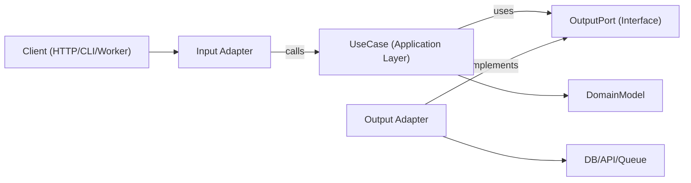

# Hexagonal Architecture

Hexagonal architecture (Ports and Adapters) keeps business logic independent from frameworks, transport, and persistence details. The core app depends on abstract ports, and adapters implement those ports at the edges.

## Priority: Performance First

Boundaries are a default, not a mandate. Follow every guideline below as far as it's free — but where a port, an adapter hop, or a dispatch indirection provably costs measurable performance on a hot path (extra allocation, dynamic dispatch, needless clone/copy, cache-unfriendly indirection), **performance wins**:

- **Bypass Intentionally:** Collapse or bypass a boundary on a hot path rather than pay for it "on principle". Leave a clear comment naming the measured cost so the shortcut reads as a deliberate choice, not architectural decay.
- **Static Dispatch:** Prefer static dispatch (generics, templates, or monomorphization) over dynamic/virtual dispatch (`dyn Trait`, interfaces, virtual methods) for ports wherever the language runtime supports it efficiently.
- **Zero-Copy Boundaries:** Do not clone or copy domain objects across a port boundary for purity's sake. Pass by reference, use pointers, or leverage move semantics where the language allows it.
- **Decoupling Tiebreaker:** Reserve tight coupling for hot paths and inner loops. Keep boundaries intact around anything with real variability (multiple infrastructure implementations, complex testability needs) or non-hot-path orchestration where decoupling is nearly free.

## When to Use

- Building new features where long-term maintainability and testability matter.
- Refactoring layered or framework-heavy code where domain logic is mixed with I/O.
- Supporting multiple interfaces for the same use case (HTTP, CLI, queue workers, cron jobs).
- Replacing infrastructure (database, external APIs, message bus) without rewriting business rules.

## Core Concepts

| Layer | Role |
| :--- | :--- |
| **Domain Model** | Business rules, entities, and value objects. Strictly zero framework or I/O imports. |
| **Use Cases** | The application layer. Orchestrates domain behavior, transactions, and workflow steps. |
| **Input Ports** | Inward contracts defining what the application can do (commands, queries, use-case interfaces). |
| **Output Ports** | Outward contracts defining what the app needs (repositories, gateways, event publishers, clock, UUID). |
| **Adapters** | Infrastructure and delivery implementations of ports. **Input adapters** drive the app (HTTP controllers, CLI, queue consumers). **Output adapters** are driven by it (DB repos, SDK wrappers, third-party APIs). |
| **Composition Root** | The single wiring location (DI container, main function) binding concrete adapters to use cases. |

*Note: Output port interfaces live in the application layer. They only reside in the domain layer when the abstraction itself represents a fundamental domain capability.*

## Dependency Direction

The dependency flow is strictly inward: 
`Adapters ➔ Application Layer ➔ Port Interfaces ➔ Domain Model ➔ Nothing External`

## How It Works

1. **Model a Use Case Boundary:** Map out one use case per command/query with specific Input/Output DTOs. Keep transport details (Express `req`, GraphQL `context`, job payload wrappers) completely outside this boundary.
2. **Define Output Ports First:** Create one port per external side effect: persistence (`UserRepositoryPort`), external calls (`BillingGatewayPort`), or cross-cutting concerns (`LoggerPort`, `ClockPort`). Ports model capabilities, never specific technologies.
3. **Implement Pure Orchestration:** Pass ports to the use case via constructor dependency injection. The use case validates application-level invariants, coordinates domain rules, and returns plain data structures.
4. **Build Adapters at the Edge:** Input adapters convert protocol-specific inputs into use-case DTOs. Output adapters map application contracts to concrete APIs, ORMs, or query builders. Data mapping stays in the adapters, never leaking into use cases.
5. **Wire at the Composition Root:** Instantiate adapters and inject them into use cases inside a centralized bootstrapper. Avoid hidden service-locators.
6. **Isolate Testing:** Unit test use cases using light fakes/mocks for ports; integration test adapters against real infrastructure (or testcontainers); run end-to-end (E2E) tests through the input adapters.

## Architecture Diagram



## Suggested Module Layout

Organize your project using a feature-first structure with explicit, isolated boundary folders:

```text
src/
  features/
    orders/
      domain/
        Order.ts
        OrderPolicy.ts
      application/
        ports/
          input/CreateOrder.ts
          output/OrderRepositoryPort.ts
          output/PaymentGatewayPort.ts
        use-cases/CreateOrderUseCase.ts
      adapters/
        input/http/createOrderRoute.ts
        output/postgres/PostgresOrderRepository.ts
        output/stripe/StripePaymentGateway.ts
      composition/ordersContainer.ts
```

## Structuring Files Within Ports & Adapters

Avoid flat directories once a feature grows. Group components by capability or business resource rather than technical classification:

```text
application/
  ports/
    input/
      files/
        UploadFile.ts
        DeleteFile.ts
      auth/
        AuthenticateUser.ts
    output/
      files/
        FileStoragePort.ts
      notifications/
        EmailGatewayPort.ts
adapters/
  input/
    http/
      files/
        uploadFileRoute.ts
        deleteFileRoute.ts
      auth/
        authRoute.ts
  output/
    files/
      s3/S3FileStorage.ts
      local/LocalFileStorage.ts
    notifications/
      sendgrid/SendgridEmailGateway.ts
```

- **Group by Capability:** Cluster files by resource (e.g., `files`, `auth`), never by technical type (e.g., `interfaces/`, `implementations/`). A folder accumulating unrelated one-off files indicates a feature boundary needs splitting.
- **Mirror Subfolder Names:** Keep subfolder names identical across `ports/input`, `ports/output`, and all `adapters/*` trees so matching sides of a boundary can be traced instantly.
- **Isolate Technologies:** Nest concrete technology names exactly one level deeper, and exclusively on the adapter side (e.g., `adapters/output/files/s3/`). The port directory remains completely technology-agnostic.
- **Transport Layering:** Input adapters may nest by transport type before capability (e.g., `adapters/input/http/files/`, `adapters/input/cli/files/`) if a feature is driven by multiple entry points.
- **Flatten Minimal Folders:** Do not create a subfolder for a single file. Keep files flat in the parent directory until a specific capability accumulates 3 or more related files.

## Swappable Adapters

A core validation of Hexagonal Architecture is the ability to interchange adapters without altering business logic. While prototypes may start with cheap implementations (in-memory arrays, stubs, local clock mocks), these are merely concrete implementations of a port, not architectural assumptions.

- **Technology-Agnostic Naming:** Name ports after their role, not their expected implementation. Use `UserRepositoryPort` or `UserStore`, never `MongoUserRepository`.
- **The Single-Line Substitution Rule:** Swapping a mock adapter for a production-ready one (e.g., moving from an in-memory mock to an Amazon S3 storage infrastructure) must only require writing the new adapter class and modifying its binding declaration inside the **Composition Root**. No application use cases or domain models should be modified during an infrastructure swap.

## TypeScript Example

```typescript
// domain/Order.ts
export class Order {
  private constructor(
    public readonly id: string,
    public readonly amountCents: number,
    public readonly status: 'PENDING' | 'AUTHORIZED',
    public readonly authorizationId: string | null = null
  ) {}

  static create(props: { id: string; amountCents: number }): Order {
    return new Order(props.id, props.amountCents, 'PENDING');
  }

  static rehydrate(row: any): Order {
    return new Order(row.id, row.amount_cents, row.status, row.authorization_id);
  }

  markAuthorized(authorizationId: string): Order {
    return new Order(this.id, this.amountCents, 'AUTHORIZED', authorizationId);
  }
}

// application/ports/output/OrderRepositoryPort.ts
export interface OrderRepositoryPort {
  save(order: Order): Promise<void>;
  findById(orderId: string): Promise<Order | null>;
}

// application/ports/output/PaymentGatewayPort.ts
export interface PaymentGatewayPort {
  authorize(input: { orderId: string; amountCents: number }): Promise<{ authorizationId: string }>;
}

// application/use-cases/CreateOrderUseCase.ts
export class CreateOrderUseCase {
  constructor(
    private readonly orderRepository: OrderRepositoryPort,
    private readonly paymentGateway: PaymentGatewayPort
  ) {}

  async execute(input: { orderId: string; amountCents: number }) {
    const order = Order.create({ id: input.orderId, amountCents: input.amountCents });
    const auth = await this.paymentGateway.authorize({ orderId: order.id, amountCents: order.amountCents });
    
    // Immutable domain update: returns a new Order instance
    const authorizedOrder = order.markAuthorized(auth.authorizationId);
    await this.orderRepository.save(authorizedOrder);
    
    return { orderId: order.id, authorizationId: auth.authorizationId };
  }
}

// adapters/output/postgres/PostgresOrderRepository.ts
export class PostgresOrderRepository implements OrderRepositoryPort {
  constructor(private readonly db: SqlClient) {}
  
  async save(order: Order): Promise<void> {
    await this.db.query(
      "insert into orders (id, amount_cents, status, authorization_id) values ($1, $2, $3, $4) " +
      "on conflict (id) do update set status = excluded.status, authorization_id = excluded.authorization_id",
      [order.id, order.amountCents, order.status, order.authorizationId]
    );
  }
  
  async findById(orderId: string): Promise<Order | null> {
    const row = await this.db.oneOrNone("select * from orders where id = $1", [orderId]);
    return row ? Order.rehydrate(row) : null;
  }
}

// adapters/output/stripe/StripePaymentGateway.ts
export class StripePaymentGateway implements PaymentGatewayPort {
  constructor(private readonly stripe: StripeClient) {}

  async authorize(input: { orderId: string; amountCents: number }) {
    const charge = await this.stripe.charges.create({
      amount: input.amountCents,
      currency: 'usd',
      metadata: { orderId: input.orderId }
    });
    return { authorizationId: charge.id };
  }
}

// composition/ordersContainer.ts — the composition root
export const buildCreateOrderUseCase = (deps: { db: SqlClient; stripe: StripeClient }) =>
  new CreateOrderUseCase(
    new PostgresOrderRepository(deps.db), 
    new StripePaymentGateway(deps.stripe)
  );
```

## Multi-Language Mapping

Same boundary rules apply across ecosystems; only syntax and wiring styles change.

- **TypeScript/JavaScript** — Ports as interfaces/types under `application/ports/*`. Use cases as classes/functions with constructor/argument injection. Adapters live under `adapters/input/*` and `adapters/output/*`. Composition via an explicit factory/container module (never hidden globals).
- **Rust** — Ports are traits defined in `domain::ports` (owned by the consumer, not the adapters) with `Clone + Send + Sync + 'static` bounds so they can safely traverse async boundaries. Async port methods use return-position `impl Future<Output = ...> + Send` (no `async-trait` macro required). **Prefer generics over `dyn Trait`** for ports (`Service<R: OrderRepository, P: PaymentGateway>`). Per [Priority: Performance First](#priority-performance-first), static dispatch allows the compiler to inline and specialize effectively; reach for `Arc<dyn Trait + Send + Sync>` only when true runtime polymorphism is required (e.g., dynamically selecting adapters at startup). Model one use case as one method on a per-capability `Service` struct to minimize unit-test noise. Modules split `domain/` from `adapters/input/` and `adapters/output/`. Never leak infrastructure types like `sqlx` or `reqwest` past the adapter boundary. If an input adapter needs custom metadata (like presentation URLs), assign it its own small state struct wrapping the application state rather than widening the core shared state. The composition root is `main.rs` (or a dedicated `bootstrap` module) where adapters are constructed, combined into a generic `Service<...>`, and wrapped in an `Arc`. Mock ports by hand-implementing traits or generating them via `mockall`'s `#[automock]`. Domain errors are exhaustive `enum`s using `thiserror`, while adapters translate infra-specific errors (SQL errors, HTTP statuses) into domain errors at the boundary.
- **Java** — Package layout: `domain`, `application.port.in`, `application.port.out`, `application.usecase`, `adapter.in`, `adapter.out`. Ports are interfaces under `application.port.*`. Use cases remain plain Java classes (Spring `@Service` annotations are optional). Manage composition via clear Spring `@Configuration` classes or manual factory classes, keeping framework dependencies completely out of domain and use-case directories.
- **Kotlin** — Mirrors the Java layout with explicit Kotlin interfaces as ports, using classes with constructor injection as use cases. Wire dependencies through functional container configurations (Koin, Dagger, Spring, or manual injection modules) while strictly avoiding service locator anti-patterns.
- **Go** — Package layout: `internal/<feature>/domain`, `application`, `ports`, `adapters/input`, `adapters/output`. Keep interfaces small, focused, and explicitly owned by the consuming package. Use cases are concrete structs containing interface fields, exposed via explicit `New...` constructors. Propagate a `context.Context` through every port method to handle cancellation and timeouts correctly. Wire dependencies explicitly in `cmd/<app>/main.go` or a dedicated infrastructure setup package.

## Anti-Patterns to Avoid

- **Leakage of Infrastructure:** Domain entities importing ORM models, web framework route types, or third-party SDK clients.
- **Impure Use Cases:** Use cases reading directly from HTTP request buffers, parsing GraphQL resolver parameters, or handling raw message queue metadata.
- **Leaking Database Schemes:** Returning database rows or raw data objects directly from use cases without explicitly translating them into domain entities or distinct application DTOs.
- **Horizontal Coupling:** Adapters calling other adapters directly across boundaries instead of routing workflows strictly through use-case input and output ports.
- **Hidden Dependencies:** Distributing dependency injection setups across dozens of files using hidden globally-accessed singletons or service-locator lookups.
- **Blind Abstraction:** Paying for an expensive port/adapter abstraction hop on an inner-loop hot path with no factual variation or testing rationale. Refer to [Priority: Performance First](#priority-performance-first) to determine when to collapse a boundary.
- **Leaky Stubs:** Designing a mock, stub, or in-memory adapter whose inner data structures, unique ID constraints, or synchronous processing assumptions leak into business assumptions past the adapter boundary.

## Testing Guidance

- **Domain Tests:** Focused exclusively on business logic and domain policies. These tests must require no infrastructure mocks, no container setups, and zero external framework boots.
- **Use-Case Unit Tests:** Isolate use-case logic by passing lightweight stubs or fakes into output ports. Assert application workflow logic, side-effect triggers, and correct port orchestration.