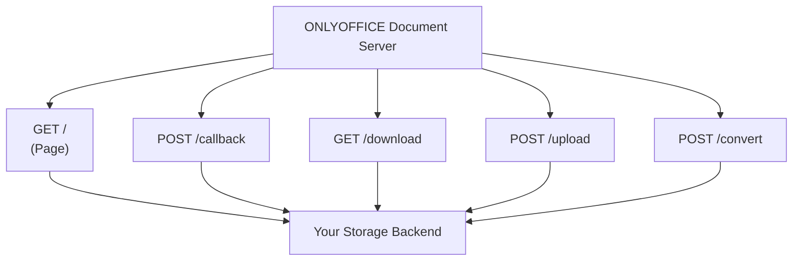

# ONLYOFFICE Docs API - Node.js Example Skill Guide

## Context & Purpose

Server-side reference implementation using the **Node.js Integration Example** (v8.2+): Express routes, upload/download paths, and session sync, based on the official sample app.

## Reference Documentation Map

* **Node.js Integration Overview:** [https://api.teamlab.info/docs/docs-api/samples/language-specific-examples/nodejs-example.md](https://api.teamlab.info/docs/docs-api/samples/language-specific-examples/nodejs-example.md)
* **Reference Production Blueprint (app.js):** https://github.com/ONLYOFFICE/document-server-integration/blob/main/web/documentserver-example/nodejs/app.js
* **Non-WOPI views** (the sample UI's actual pages — see "Optional Sample UI" below): [`index.ejs`](https://github.com/ONLYOFFICE/document-server-integration/blob/main/web/documentserver-example/nodejs/views/index.ejs) (file list, upload, create-new), [`editor.ejs`](https://github.com/ONLYOFFICE/document-server-integration/blob/main/web/documentserver-example/nodejs/views/editor.ejs) (the `DocsAPI.DocEditor` embed + full event wiring), [`config.ejs`](https://github.com/ONLYOFFICE/document-server-integration/blob/main/web/documentserver-example/nodejs/views/config.ejs) (the config object `editor.ejs` includes), [`jscript.js`](https://github.com/ONLYOFFICE/document-server-integration/blob/main/web/documentserver-example/nodejs/public/javascripts/jscript.js) (the sample UI's client-side upload/convert/modal wiring `index.ejs` calls into). Ignore `wopiAction.ejs`/`wopiIndex.ejs` — those back the separate WOPI host mode, out of scope here.
* **How the generated UI is supposed to look:** [`ui.md`](./ui.md) — the design bar, faithful-port vs. designed-app mode, always built on ONLYOFFICE's own `docspace-ui-kit-react` (a named style themes it, never replaces it), and the style/layout/shape questions asked rather than assumed.
* **If the user has a local, pinned checkout of `document-server-integration` on disk, prefer it over fetching a branch from GitHub.** Branches drift, and a local checkout is frequently a *different* (often newer) revision than `main` — with different icon filenames, different markup for the same feature, or scripts the fetched branch doesn't have. Diff both if unsure which the user means; never assume they match.

## Documentation Query Rules

* **Baseline:** Per `api.md` — this guide is self-sufficient. A bare filename below with no path (`api.md`, `configuration/*.md`, `signature/*.md`, `callback/handler.md`, `methods.md`) is the sibling **`doceditor`** skill's file, not one in this directory — this skill scaffolds the sample; `doceditor` is the authority on the API contract each piece implements.
* **Fallback:** Check the reference repo only for edge-case flows (ZIP delta compression via `changesurl`, base64 avatar uploads). For the `GET /` page's client-side `DocsAPI.DocEditor` wiring itself, go to `api.md` instead.
* **Process checklist:** [`example-checklist.md`](./example-checklist.md) — language-agnostic verification steps to run through before considering a generated sample done, regardless of target language.
* **Source for "new"/"sample" files:** [`templates.md`](./templates.md) — where the create-new-by-format buttons' blank files and the initial demo/seed content actually come from.

## Routing Map

A server integration needs five endpoints — four that make up the contract a third-party integrates against, all of them mounted regardless of what this deliverable's own UI happens to call, plus the embedding page, which is the one optional and removable piece ([`infrastructure/backend.md`](infrastructure/backend.md)):

### Endpoints
* **`GET /`** — serves the page embedding `DocsAPI.DocEditor` and its config — see `api.md` for the constructor and `configuration/config.md` for the payload.
* **`POST /callback`** — receives editor callbacks; handles `status === 2`/`6` (save/force-save) by fetching and storing the file — see `callback/handler.md` for the full contract. *(The official Node.js sample itself literally names this route `/track` — matters for a faithful-port request, which has to match the real reference exactly; `/callback` is this skill's own recommended name for a newly generated backend, since nothing about the protocol requires either name — `editorConfig.callbackUrl` points wherever the backend actually mounts it.)*
* **`GET /download`** — streams the file to ONLYOFFICE Docs after validating the token; this is `document.url` from `configuration/document.md`.
* **`POST /upload`** — ingests local files, enforcing size limits.
* **`POST /convert`** — converts formats via the Document Server — see the sibling **`web-converter`** skill for the request/response schema and error codes. **This route gets mounted even when nothing in the deliverable calls it.** The common way it goes missing is a sample whose only conversion need is the legacy-upload auto-convert path below: the capability gets written as an internal step inside the upload handler and no route is ever exposed, leaving an integrator — the audience this backend exists for — with no way to convert a file on demand. Auto-convert-on-upload calls the same conversion code *behind* this endpoint; it does not stand in for it.

## Optional Sample UI

The embedding page (`GET /`) is **optional infrastructure, not part of the integration contract** — see [`infrastructure/backend.md`](infrastructure/backend.md) for the general rule. Default to generating the backend only (`callback`/`download`/`upload`/`convert`, plus whatever config/list endpoints the integration needs); build a page only when the user explicitly asks for a sample/demo app.

When they do, the reference shape is the Node.js example's **non-WOPI views** (linked above), not a bare `DocsAPI.DocEditor` snippet:
* **`index.ejs`** — a file list (not a single hardcoded document): per-file links for each supported mode (`edit`, `view`, `comment`, `review`, `fillForms`, `embedded`, desktop/mobile variants), delete, rename, an upload form, create new buttons, and username/language pickers to simulate different users. The create new buttons and the file list's initial seed content both come from vendored binaries, not generated ones — see [`templates.md`](./templates.md) for sourcing the blank per-format/per-locale "new" files and the pre-populated "sample" set from [`ONLYOFFICE/document-templates`](https://github.com/ONLYOFFICE/document-templates). Uploading a legacy binary format (`.doc`/`.xls`/`.ppt`/`.odt`/...) isn't a bare store-and-list — check the format-capability table's `"auto-convert"` action (not just `"edit"`) and, when present, silently convert to that format family's native OOXML target (word->docx, cell->xlsx, slide->pptx) before offering Edit, surfacing the same Loading -> Conversion progress the reference shows via `#mainProgress` — that exact element in a faithful port, or a real progress surface built to [`ui.md`](./ui.md)'s bar in a designed app, fed by the conversion response's own `percent` rather than an animation.
* **`editor.ejs`** — the `DocsAPI.DocEditor` embed itself, wired to *all* the event handlers a real integration needs, not just `onDocumentReady`/`onDocumentStateChange`: `onRequestClose`, `onRequestEditRights`, `onMetaChange`, `onRequestRename`, `onRequestSaveAs`, `onRequestHistory`/`onRequestRestore` (version history), `onRequestUsers` (mentions), `onRequestInsertImage`/`onRequestSelectDocument`/`onRequestSelectSpreadsheet` (mail merge / reference data), per `configuration/events.md`. Since this sample UI has an `index.ejs` file list to return to, `editorConfig.customization.goback` must point at it and `onRequestClose` must actually navigate there — see `configuration/editor.md` — rather than leaving the visitor on whatever `destroyEditor()` left behind.

When the deliverable includes real per-user authentication (login/registration issuing real sessions, not just a username picker simulating different users), the file list's ownership scope is a decision to make explicitly, not a default to fall into: either every authenticated user can see/rename/delete every file (a deliberately shared "team drive" — fine for a demo, but say so rather than leaving it implicit) or file access is checked against the requesting user's identity. The unscoped default is the one that happens by accident — real login screens make an integration look access-controlled even when the file store behind them never checks who's asking, which is a materially different (and weaker) thing than what "production-ready" or "secure" usually implies once real auth is in the picture.

A full sample UI at this fidelity needs backend routes beyond the core surface: at minimum a file-listing endpoint and delete/rename. Cross-file reference data (`/reference`, insert-image / select-doc pickers) stays an optional layer — add it only when the user asks for that feature. **Version history is different:** when the request names historical versions, version comparison, restore, or the history panel, it is **required for that deliverable**, not optional colour. Build the storage subsystem the Node example's `/historyObj`/`/restore` imply, and wire the client path end-to-end — see `configuration/events.md` (`onRequestHistory`/`onRequestRestore`) and `methods.md` (`refreshHistory`/`setHistoryData`). Each persisted version records at least: an incremented version number, the actor, the snapshot/`changesurl` location, and a **content hash (checksum) of the saved bytes**. A version number and timestamp alone cannot detect silent truncation or corruption after the fact; the hash can. There is no static `history` field to drop into the editor config — the editor asks via events and you answer with methods. None of this belongs in the reusable backend a third-party system integrates against when the user never asked for history; when they did, shipping the UI without it is an incomplete demo, not a scoped reduction.

If you reuse `index.ejs`'s CSS verbatim rather than writing your own, reuse its exact per-row DOM structure too — don't just borrow the class names. Its file-list rows are laid out with flexbox and fixed per-icon percentage widths (`.tableRow`, `.contentCells-icon`); the header row's grouped widths only line up with the body if every row emits the *same* number of icon cells in the *same* order, populated or left empty, matching `index.ejs`'s own branches exactly. Merging two slots into one, dropping a slot, adding a slot the original doesn't have, or swapping an icon for something wider (an inline `<select>`, say) breaks the visual alignment silently — nothing errors, it just misaligns.

Two more silent-failure spots in the same vein: (1) `index.ejs` reuses the *same* `desktop.svg`/`mobile.svg` icons for both edit and view (only the `mode=` query param differs) — don't invent distinct edit/view icon filenames, and don't reach for the visually-similar `wopi-*` prefixed icon set sitting in the same `images/` directory, that's a different feature entirely (WOPI host mode, out of scope per above); (2) the upload/convert modals' dialog width (`539px`) isn't in any CSS file at all — it's `jscript.js`'s own `blockUI({ themedCSS: { width: "539px", ... } })` call, easy to miss if you only diff the stylesheet.

If you're not using `blockUI`/jQuery (a from-scratch port in another language commonly won't), you're on your own for the overlay/centering CSS it normally provides — write it fresh around the *reused* `.blockPage`/`.blockTitle`/`.dialog-close`/`.step*`/`.buttonsMobile` classes rather than reinventing those too, and match blockUI's own numeric layout constraints (width above) so wrapping/spacing looks the same. See [`example-checklist.md`](./example-checklist.md) for the comment-token and CSS-parse-validation traps this kind of freehand addition tends to hit.

### Styling

Everything above describes what the reference sample *does* — it is the **feature floor, not the visual ceiling**. [`ui.md`](./ui.md) holds the bar the generated UI is actually held to: choosing between a faithful port (where the fidelity rules in this section apply verbatim) and a designed app (the default, where they don't), settling the design tokens before the first component, and the state, responsive, motion and accessibility requirements that separate a product from a test harness. The one rule worth repeating here: a component with no counterpart in `index.ejs` still gets styled in whatever direction applies — "the reference didn't have this" ships bare browser-default markup, which reads exactly as broken as a bug to whoever is clicking through the demo.

## Security

* Lock down production endpoints to prevent arbitrary file deletion.
* Verify `Authorization` tokens and inner payload claims to block substitution attacks — see `signature/header.md` and `signature/body.md`.

Full Express.js code and config parameters: see the repository and docs above.