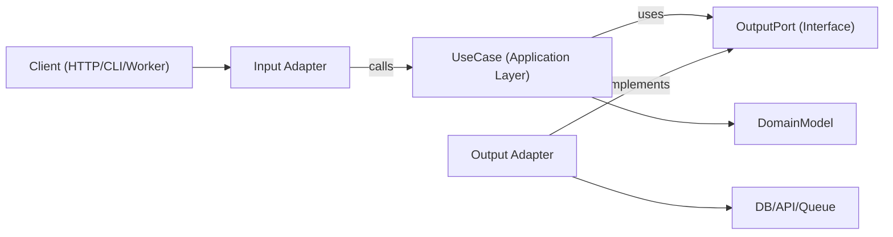

# Hexagonal Architecture

Hexagonal architecture (Ports and Adapters) keeps business logic independent from frameworks, transport, and persistence details. The core app depends on abstract ports, and adapters implement those ports at the edges.

## Priority: Performance First

Boundaries are a default, not a mandate. Follow every guideline below as far as it's free — but where a port, an adapter hop, or a dispatch indirection provably costs measurable performance on a hot path (extra allocation, dynamic dispatch, needless clone/copy, cache-unfriendly indirection), **performance wins**:

- Collapse or bypass a boundary on a hot path rather than pay for it "on principle" — but leave a comment naming the measured cost, so the shortcut reads as deliberate, not decayed architecture.
- Prefer static dispatch (generics/monomorphization) over `dyn Trait`/virtual dispatch for ports wherever the language supports it — codified per-language below (Rust already defaults to this).
- Don't clone/copy domain objects across a port boundary for purity's sake — pass by reference or move where the language allows it.
- This is a tiebreaker for hot paths and inner loops, not a license to skip ports everywhere — keep them around anything with real variability (multiple infra implementations, a real testability need) or non-hot-path orchestration, where the decoupling is nearly free and the maintainability win is real.

## When to Use

- Building new features where long-term maintainability and testability matter.
- Refactoring layered or framework-heavy code where domain logic is mixed with I/O.
- Supporting multiple interfaces for the same use case (HTTP, CLI, queue workers, cron jobs).
- Replacing infrastructure (database, external APIs, message bus) without rewriting business rules.

## Core Concepts

| Layer | Role |
| :--- | :--- |
| Domain model | Business rules, entities/value objects. No framework imports. |
| Use cases (application layer) | Orchestrate domain behavior and workflow steps. |
| Input ports | Contracts for what the app can do (commands/queries/use-case interfaces). |
| Output ports | Contracts for what the app needs (repositories, gateways, event publishers, clock, UUID, …). |
| Adapters | Infra/delivery implementations of ports, split by direction: **input** adapters drive the app (HTTP controllers, CLI, queue consumers); **output** adapters are driven by it (DB repos, SDK wrappers). |
| Composition root | Single wiring location binding concrete adapters to use cases. |

Output port interfaces usually live in the application layer (domain only when the abstraction is truly domain-level).

Dependency direction is always inward: **adapters -> application/domain -> port interfaces -> domain-only abstractions -> nothing external.**

## How It Works

1. **Model a use case boundary** — one use case, one input/output DTO. Keep transport details (Express `req`, GraphQL `context`, job payload wrappers) outside it.
2. **Define output ports first** — one per side effect: persistence (`UserRepositoryPort`), external calls (`BillingGatewayPort`), cross-cutting (`LoggerPort`, `ClockPort`). Ports model capabilities, not technologies.
3. **Implement the use case as pure orchestration** — it receives ports via constructor/arguments, validates application-level invariants, coordinates domain rules, and returns plain data structures.
4. **Build adapters at the edge** — input adapters convert protocol input to use-case input; output adapters map app contracts to concrete APIs/ORM/query builders. Mapping stays in adapters, never in use cases.
5. **Wire everything in a composition root** — instantiate adapters, inject into use cases, keep it centralized to avoid hidden service-locator behavior.
6. **Test per boundary** — unit test use cases with fake ports; integration test adapters against real infra; E2E test user-facing flows through input adapters.

## Architecture Diagram



## Suggested Module Layout

Feature-first organization with explicit boundaries:

```text
src/
  features/
    orders/
      domain/
        Order.ts
        OrderPolicy.ts
      application/
        ports/
          input/CreateOrder.ts
          output/OrderRepositoryPort.ts
          output/PaymentGatewayPort.ts
        use-cases/CreateOrderUseCase.ts
      adapters/
        input/http/createOrderRoute.ts
        output/postgres/PostgresOrderRepository.ts
        output/stripe/StripePaymentGateway.ts
      composition/ordersContainer.ts
```

## Structuring Files Within ports/adapters

Once a `ports/input`, `ports/output`, or `adapters/*` folder grows past a handful of files, stop dumping them flat — group by capability/resource (e.g. `files`, `auth`, `notifications`), not by technical type, and mirror the same subfolder names across every side of the boundary so a port and its adapter(s) stay trivially easy to trace:

```text
application/
  ports/
    input/
      files/
        UploadFile.ts
        DeleteFile.ts
      auth/
        AuthenticateUser.ts
    output/
      files/
        FileStoragePort.ts
      notifications/
        EmailGatewayPort.ts
adapters/
  input/
    http/
      files/
        uploadFileRoute.ts
        deleteFileRoute.ts
      auth/
        authRoute.ts
  output/
    files/
      s3/S3FileStorage.ts
      local/LocalFileStorage.ts
    notifications/
      sendgrid/SendgridEmailGateway.ts
```

- Group by capability/resource, never by technical type — a folder accumulating unrelated one-off ports is usually a sign the feature itself needs splitting, not that the folder needs an "other" bucket.
- Keep the capability subfolder name identical across `ports/input`, `ports/output`, and every `adapters/*` tree — `files` under one is `files` under all of them, so the port and its adapters sit at matching paths.
- Nest the concrete technology one level deeper, and only on the adapter side, when a single output port has multiple implementations (`adapters/output/files/s3/`, `adapters/output/files/local/`) — the port folder itself stays technology-free.
- Input adapters may nest by transport before capability (`adapters/input/http/files/`, `adapters/input/cli/files/`) when one feature is driven by more than one transport.
- Don't create a subfolder for a single file — flatten a capability back to loose files in the parent folder until it earns its own directory (roughly 3+ files).

## TypeScript Example

```typescript
// application/ports/output
export interface OrderRepositoryPort {
  save(order: Order): Promise<void>;
  findById(orderId: string): Promise<Order | null>;
}
export interface PaymentGatewayPort {
  authorize(input: { orderId: string; amountCents: number }): Promise<{ authorizationId: string }>;
}

// application/use-cases/CreateOrderUseCase.ts
export class CreateOrderUseCase {
  constructor(
    private readonly orderRepository: OrderRepositoryPort,
    private readonly paymentGateway: PaymentGatewayPort
  ) {}

  async execute(input: { orderId: string; amountCents: number }) {
    const order = Order.create({ id: input.orderId, amountCents: input.amountCents });
    const auth = await this.paymentGateway.authorize({ orderId: order.id, amountCents: order.amountCents });
    // markAuthorized returns a new Order instance; it does not mutate in place.
    await this.orderRepository.save(order.markAuthorized(auth.authorizationId));
    return { orderId: order.id, authorizationId: auth.authorizationId };
  }
}

// adapters/output/postgres/PostgresOrderRepository.ts
export class PostgresOrderRepository implements OrderRepositoryPort {
  constructor(private readonly db: SqlClient) {}
  async save(order: Order) {
    await this.db.query(
      "insert into orders (id, amount_cents, status, authorization_id) values ($1, $2, $3, $4)",
      [order.id, order.amountCents, order.status, order.authorizationId]
    );
  }
  async findById(orderId: string) {
    const row = await this.db.oneOrNone("select * from orders where id = $1", [orderId]);
    return row ? Order.rehydrate(row) : null;
  }
}

// composition/ordersContainer.ts — the composition root
export const buildCreateOrderUseCase = (deps: { db: SqlClient; stripe: StripeClient }) =>
  new CreateOrderUseCase(new PostgresOrderRepository(deps.db), new StripePaymentGateway(deps.stripe));
```

## Multi-Language Mapping

Same boundary rules across ecosystems; only syntax and wiring style change.

- **TypeScript/JavaScript** — Ports as interfaces/types under `application/ports/*`. Use cases as classes/functions with constructor/argument injection. Adapters under `adapters/input/*`, `adapters/output/*`. Composition via an explicit factory/container module (no hidden globals).
- **Rust** — Ports are traits, defined once in `domain::ports` (owned by the consumer, not the adapters — same rule as Go below) with `Clone + Send + Sync + 'static` bounds so they can be injected across async boundaries; async port methods use return-position `impl Future<Output = ...> + Send` (no `async-trait` needed on modern Rust). **Prefer generics over `dyn Trait`** for ports (`Service<R: OrderRepository, P: PaymentGateway>`) — per [Priority: Performance First](#priority-performance-first), static dispatch keeps the compiler able to inline and specialize; reach for `Arc<dyn Trait + Send + Sync>` only when true runtime polymorphism is required (e.g. a registry of adapters chosen at startup), not by default. Model one use case as one method on a per-capability `Service` struct (generic over its port type parameters, e.g. `AppService<S: Storage, D: Gateway>`) rather than a standalone "use case" type — keeps the unit-test surface small. Modules split `domain/` (entities, port traits, the `Service`) from `adapters/input/` (HTTP/CLI/queue handlers driving it) and `adapters/output/` (repository/gateway adapters wrapping third-party crates — never leak `sqlx`/`reqwest` types past the adapter). A handler needing adapter-only data (e.g. a URL to render, not a business value) takes its own small state struct wrapping the shared one, mounted on its own sub-router - don't widen the shared state for one adapter's presentation need. Composition root is `main.rs` (or a dedicated `bootstrap`/`wiring` module): construct concrete adapters, combine into a generic `Service<...>`, wrap in `Arc` for app state. Mock ports for tests by hand-implementing the trait, or generate mocks with [`mockall`](https://docs.rs/mockall)'s `#[automock]`. Domain errors are exhaustive `enum`s via `thiserror`; adapters translate infra-specific errors (SQL constraint codes, HTTP statuses) into them at the boundary.
- **Java** — Packages `domain`, `application.port.in`, `application.port.out`, `application.usecase`, `adapter.in`, `adapter.out`. Ports as interfaces in `application.port.*`. Use cases as plain classes (Spring `@Service` optional). Composition via Spring config or a manual wiring class, kept out of domain/use-case classes.
- **Kotlin** — Mirrors the Java split (`domain`, `application.port`, `application.usecase`, `adapter`) with Kotlin interfaces as ports, classes with constructor injection (Koin/Dagger/Spring/manual) as use cases, and module definitions or dedicated composition functions for wiring — avoid service locator patterns.
- **Go** — Packages `internal/<feature>/domain`, `application`, `ports`, `adapters/input`, `adapters/output`. Small interfaces owned by the consuming application package as ports. Use cases as structs with interface fields plus explicit `New...` constructors. Composition wired in `cmd/<app>/main.go` (or a dedicated wiring package) with explicit constructors.

## Anti-Patterns to Avoid

- Domain entities importing ORM models, web framework types, or SDK clients.
- Use cases reading directly from `req`, `res`, or queue metadata.
- Returning database rows directly from use cases without domain/application mapping.
- Adapters calling each other directly instead of flowing through use-case ports.
- Dependency wiring spread across many files with hidden global singletons.
- Paying for a port/adapter hop on a hot path with no measured reason — see [Priority: Performance First](#priority-performance-first) for when to collapse it instead.

## Migration Playbook (Brownfield)

1. Pick one vertical slice (single endpoint/job) with frequent change pain — prioritize high-churn, low-blast-radius flows.
2. Extract a use-case boundary with explicit input/output types.
3. Introduce output ports around existing infrastructure calls; wrap legacy services behind them before touching internals (facade first).
4. Move orchestration logic from controllers/services into the use case.
5. Keep old adapters, but make them delegate to the new use case (strangler approach — no big-bang rewrites, migrate per feature slice).
6. Add characterization tests before extraction, then boundary tests (unit + adapter integration) once it's stable.
7. Repeat slice-by-slice, keeping a reversible toggle/route switch per slice until production behavior is verified.
8. Centralize wiring early (composition freeze) so new dependencies don't leak into domain/use-case layers.

## Testing Guidance

- **Domain tests**: pure business rules, no mocks, no framework setup.
- **Use-case unit tests**: fakes/stubs for output ports; assert business outcomes and port interactions.
- **Output adapter contract tests**: one shared contract suite per port, run against each adapter implementation.
- **Input adapter tests**: verify protocol mapping (HTTP/CLI/queue payload -> use-case input, and output/error mapping back to the protocol).
- **Adapter integration tests**: real infrastructure (DB/API/queue) for serialization, schema/query behavior, retries, timeouts.
- **End-to-end tests**: critical user journeys through input adapter -> use case -> output adapter.
- **Refactor safety**: characterization tests before extraction, kept until the new boundary is verified equivalent.

## Best Practices Checklist

- On a measured hot path, performance beats boundary purity — collapse or bypass with a comment (see [Priority: Performance First](#priority-performance-first)); everywhere else, keep the boundary.
- Domain and use-case layers import only internal types and ports.
- Every external dependency is represented by an output port.
- Validation happens at boundaries (input adapter + use-case invariants).
- Immutable transformations — return new values/entities instead of mutating shared state.
- Errors are translated across boundaries (infra errors -> application/domain errors).
- Composition root is explicit and easy to audit.
- Use cases are testable with simple in-memory fakes for ports.
- Refactoring starts from one vertical slice with behavior-preserving tests.
- Language/framework specifics stay in adapters, never in domain rules.