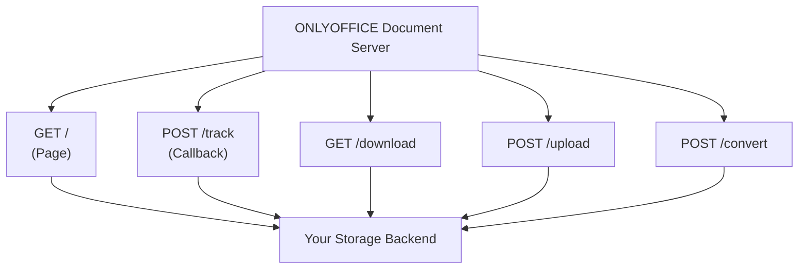

# ONLYOFFICE Docs API - Node.js Example Skill Guide

## Context & Purpose

Server-side reference implementation using the **Node.js Integration Example** (v8.2+): Express routes, upload/download paths, and session sync, based on the official sample app.

## Reference Documentation Map

* **Node.js Integration Overview:** https://api.onlyoffice.com/docs/docs-api/samples/language-specific-examples/nodejs-example/
* **Reference Production Blueprint (app.js):** https://github.com/ONLYOFFICE/document-server-integration/blob/master/web/documentserver-example/nodejs/app.js
* **Non-WOPI views** (the sample UI's actual pages — see "Optional Sample UI" below): [`index.ejs`](https://github.com/ONLYOFFICE/document-server-integration/blob/main/web/documentserver-example/nodejs/views/index.ejs) (file list, upload, create-new), [`editor.ejs`](https://github.com/ONLYOFFICE/document-server-integration/blob/main/web/documentserver-example/nodejs/views/editor.ejs) (the `DocsAPI.DocEditor` embed + full event wiring), [`config.ejs`](https://github.com/ONLYOFFICE/document-server-integration/blob/main/web/documentserver-example/nodejs/views/config.ejs) (the config object `editor.ejs` includes), [`jscript.js`](https://github.com/ONLYOFFICE/document-server-integration/blob/main/web/documentserver-example/nodejs/public/javascripts/jscript.js) (the sample UI's client-side upload/convert/modal wiring `index.ejs` calls into). Ignore `wopiAction.ejs`/`wopiIndex.ejs` — those back the separate WOPI host mode, out of scope here.
* **If the user has a local, pinned checkout of `document-server-integration` on disk, prefer it over fetching a branch from GitHub.** Branches drift, and a local checkout is frequently a *different* (often newer) revision than `main` — with different icon filenames, different markup for the same feature, or scripts the fetched branch doesn't have. Diff both if unsure which the user means; never assume they match.

## Documentation Query Rules

* **Baseline:** Per [`api.md`](./api.md) — this guide is self-sufficient.
* **Fallback:** Check the reference repo only for edge-case flows (ZIP delta compression via `changesurl`, base64 avatar uploads). For the `GET /` page's client-side `DocsAPI.DocEditor` wiring itself, go to [`api.md`](./api.md) instead.
* **Process checklist:** [`example-checklist.md`](./example-checklist.md) — language-agnostic verification steps to run through before considering a generated sample done, regardless of target language.
* **Source for "new"/"sample" files:** [`templates.md`](./templates.md) — where the create-new-by-format buttons' blank files and the initial demo/seed content actually come from.

## Routing Map

A server integration needs five endpoints:

### Endpoints
* **`GET /`** — serves the page embedding `DocsAPI.DocEditor` and its config — see [`api.md`](./api.md) for the constructor and [`configuration/config.md`](./configuration/config.md) for the payload.
* **`POST /track`** — receives editor callbacks; handles `status === 2`/`6` (save/force-save) by fetching and storing the file — see [`callback/handler.md`](./callback/handler.md) for the full contract.
* **`GET /download`** — streams the file to ONLYOFFICE Docs after validating the token; this is `document.url` from [`configuration/document.md`](./configuration/document.md).
* **`POST /upload`** — ingests local files, enforcing size limits.
* **`POST /convert`** — converts formats via the Document Server — see [`additional/conversion/conversion.md`](./additional/conversion/conversion.md) for the request/response schema and error codes.

## Optional Sample UI

The embedding page (`GET /`) is **optional infrastructure, not part of the integration contract** — see [`infrastructure/backend.md`](infrastructure/backend.md) for the general rule. Default to generating the backend only (`track`/`download`/`upload`/`convert`, plus whatever config/list endpoints the integration needs); build a page only when the user explicitly asks for a sample/demo app.

When they do, the reference shape is the Node.js example's **non-WOPI views** (linked above), not a bare `DocsAPI.DocEditor` snippet:
* **`index.ejs`** — a file list (not a single hardcoded document): per-file links for each supported mode (`edit`, `view`, `comment`, `review`, `fillForms`, `embedded`, desktop/mobile variants), delete, rename, an upload form, create new buttons, and username/language pickers to simulate different users. The create new buttons and the file list's initial seed content both come from vendored binaries, not generated ones — see [`templates.md`](./templates.md) for sourcing the blank per-format/per-locale "new" files and the pre-populated "sample" set from [`ONLYOFFICE/document-templates`](https://github.com/ONLYOFFICE/document-templates). Uploading a legacy binary format (`.doc`/`.xls`/`.ppt`/`.odt`/...) isn't a bare store-and-list — check the format-capability table's `"auto-convert"` action (not just `"edit"`) and, when present, silently convert to that format family's native OOXML target (word->docx, cell->xlsx, slide->pptx) before offering Edit, showing the same "Loading" -> "Conversion" progress `index.ejs` shows via `#mainProgress`.
* **`editor.ejs`** — the `DocsAPI.DocEditor` embed itself, wired to *all* the event handlers a real integration needs, not just `onDocumentReady`/`onDocumentStateChange`: `onRequestClose`, `onRequestEditRights`, `onMetaChange`, `onRequestRename`, `onRequestSaveAs`, `onRequestHistory`/`onRequestRestore` (version history), `onRequestUsers` (mentions), `onRequestInsertImage`/`onRequestSelectDocument`/`onRequestSelectSpreadsheet` (mail merge / reference data), per [`configuration/events.md`](./configuration/events.md).

A full sample UI at this fidelity needs backend routes beyond the core five: at minimum a file-listing endpoint and delete/rename; version history and cross-file reference data need their own storage subsystems (see the Node example's `/historyObj`, `/restore`, `/reference`) — treat those as separate, optional layers to add only if the user asks for that specific feature, same as the page itself. None of this belongs in the reusable backend a third-party system integrates against — it's presentation for the demo only.

If you reuse `index.ejs`'s CSS verbatim rather than writing your own, reuse its exact per-row DOM structure too — don't just borrow the class names. Its file-list rows are laid out with flexbox and fixed per-icon percentage widths (`.tableRow`, `.contentCells-icon`); the header row's grouped widths only line up with the body if every row emits the *same* number of icon cells in the *same* order, populated or left empty, matching `index.ejs`'s own branches exactly. Merging two slots into one, dropping a slot, adding a slot the original doesn't have, or swapping an icon for something wider (an inline `<select>`, say) breaks the visual alignment silently — nothing errors, it just misaligns.

Two more silent-failure spots in the same vein: (1) `index.ejs` reuses the *same* `desktop.svg`/`mobile.svg` icons for both edit and view (only the `mode=` query param differs) — don't invent distinct edit/view icon filenames, and don't reach for the visually-similar `wopi-*` prefixed icon set sitting in the same `images/` directory, that's a different feature entirely (WOPI host mode, out of scope per above); (2) the upload/convert modals' dialog width (`539px`) isn't in any CSS file at all — it's `jscript.js`'s own `blockUI({ themedCSS: { width: "539px", ... } })` call, easy to miss if you only diff the stylesheet.

If you're not using `blockUI`/jQuery (a from-scratch port in another language commonly won't), you're on your own for the overlay/centering CSS it normally provides — write it fresh around the *reused* `.blockPage`/`.blockTitle`/`.dialog-close`/`.step*`/`.buttonsMobile` classes rather than reinventing those too, and match blockUI's own numeric layout constraints (width above) so wrapping/spacing looks the same. See [`example-checklist.md`](./example-checklist.md) for the comment-token and CSS-parse-validation traps this kind of freehand addition tends to hit.

## Security

* Lock down production endpoints to prevent arbitrary file deletion.
* Verify `Authorization` tokens and inner payload claims to block substitution attacks — see [`signature/header.md`](./signature/header.md) and [`signature/body.md`](./signature/body.md).

Full Express.js code and config parameters: see the repository and docs above.